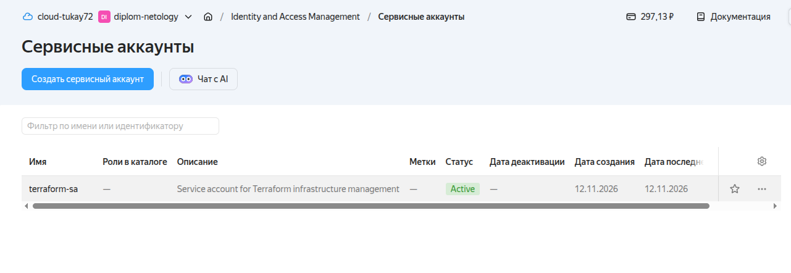
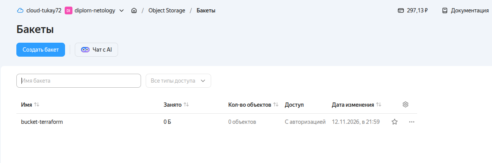
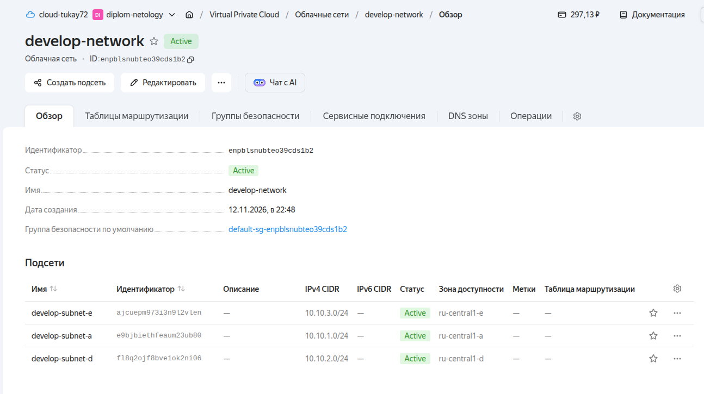
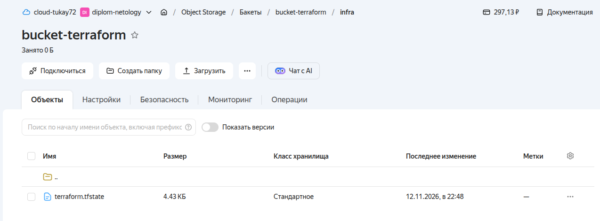
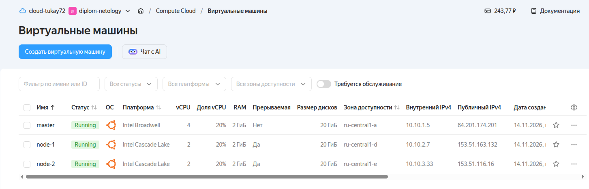
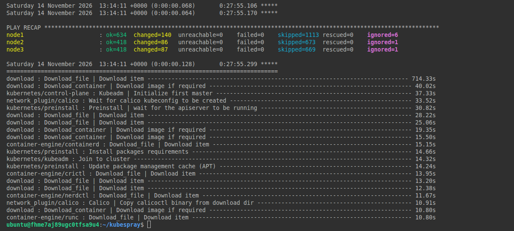
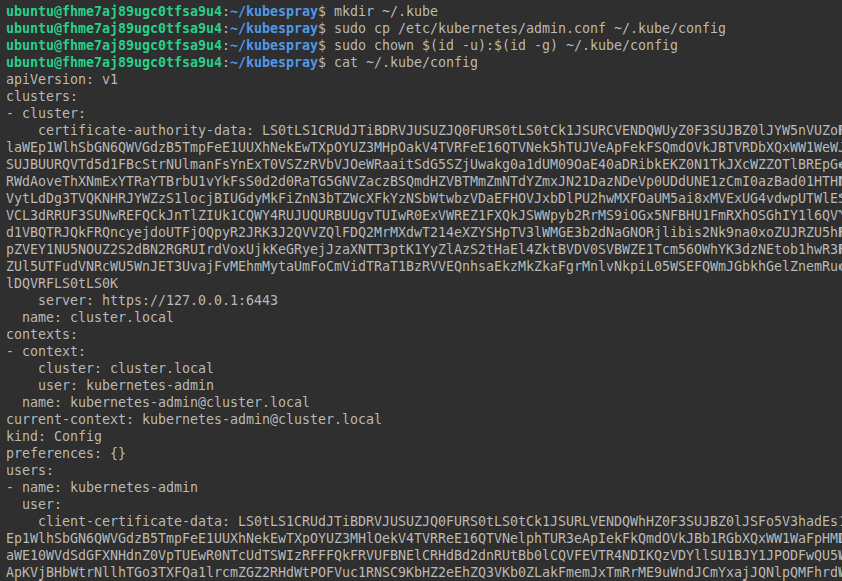
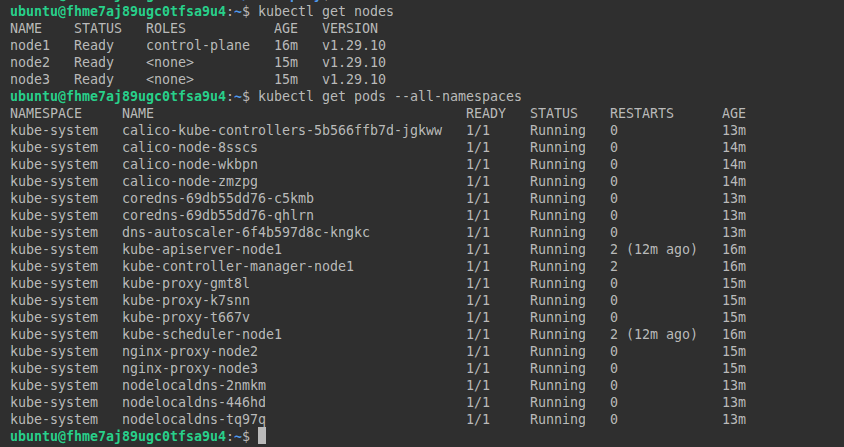

# Дипломный практикум в Yandex.Cloud. Тукаев Айрат.
  * [Цели:](#цели)
  * [Этапы выполнения:](#этапы-выполнения)
     * [Создание облачной инфраструктуры](#создание-облачной-инфраструктуры)
     * [Создание Kubernetes кластера](#создание-kubernetes-кластера)
     * [Создание тестового приложения](#создание-тестового-приложения)
     * [Подготовка cистемы мониторинга и деплой приложения](#подготовка-cистемы-мониторинга-и-деплой-приложения)
     * [Установка и настройка CI/CD](#установка-и-настройка-cicd)
  * [Что необходимо для сдачи задания?](#что-необходимо-для-сдачи-задания)
  * [Как правильно задавать вопросы дипломному руководителю?](#как-правильно-задавать-вопросы-дипломному-руководителю)

**Перед началом работы над дипломным заданием изучите [Инструкция по экономии облачных ресурсов](https://github.com/netology-code/devops-materials/blob/master/cloudwork.MD).**

---
## Цели:

1. Подготовить облачную инфраструктуру на базе облачного провайдера Яндекс.Облако.
2. Запустить и сконфигурировать Kubernetes кластер.
3. Установить и настроить систему мониторинга.
4. Настроить и автоматизировать сборку тестового приложения с использованием Docker-контейнеров.
5. Настроить CI для автоматической сборки и тестирования.
6. Настроить CD для автоматического развёртывания приложения.

---
## Этапы выполнения:


### Создание облачной инфраструктуры

Для начала необходимо подготовить облачную инфраструктуру в ЯО при помощи [Terraform](https://www.terraform.io/).

Особенности выполнения:

- Бюджет купона ограничен, что следует иметь в виду при проектировании инфраструктуры и использовании ресурсов;
Для облачного k8s используйте региональный мастер(неотказоустойчивый). Для self-hosted k8s минимизируйте ресурсы ВМ и долю ЦПУ. В обоих вариантах используйте прерываемые ВМ для worker nodes.

Предварительная подготовка к установке и запуску Kubernetes кластера.

1. Создайте сервисный аккаунт, который будет в дальнейшем использоваться Terraform для работы с инфраструктурой с необходимыми и достаточными правами. Не стоит использовать права суперпользователя
2. Подготовьте [backend](https://developer.hashicorp.com/terraform/language/backend) для Terraform:  
   а. Рекомендуемый вариант: S3 bucket в созданном ЯО аккаунте(создание бакета через TF)
   б. Альтернативный вариант:  [Terraform Cloud](https://app.terraform.io/)
3. Создайте конфигурацию Terrafrom, используя созданный бакет ранее как бекенд для хранения стейт файла. Конфигурации Terraform для создания сервисного аккаунта и бакета и основной инфраструктуры следует сохранить в разных папках.
4. Создайте VPC с подсетями в разных зонах доступности.
5. Убедитесь, что теперь вы можете выполнить команды `terraform destroy` и `terraform apply` без дополнительных ручных действий.
6. В случае использования [Terraform Cloud](https://app.terraform.io/) в качестве [backend](https://developer.hashicorp.com/terraform/language/backend) убедитесь, что применение изменений успешно проходит, используя web-интерфейс Terraform cloud.

Ожидаемые результаты:

1. Terraform сконфигурирован и создание инфраструктуры посредством Terraform возможно без дополнительных ручных действий, стейт основной конфигурации сохраняется в бакете или Terraform Cloud
2. Полученная конфигурация инфраструктуры является предварительной, поэтому в ходе дальнейшего выполнения задания возможны изменения.

---
### Создание Kubernetes кластера

На этом этапе необходимо создать [Kubernetes](https://kubernetes.io/ru/docs/concepts/overview/what-is-kubernetes/) кластер на базе предварительно созданной инфраструктуры.   Требуется обеспечить доступ к ресурсам из Интернета.

Это можно сделать двумя способами:

1. Рекомендуемый вариант: самостоятельная установка Kubernetes кластера.  
   а. При помощи Terraform подготовить как минимум 3 виртуальных машины Compute Cloud для создания Kubernetes-кластера. Тип виртуальной машины следует выбрать самостоятельно с учётом требовании к производительности и стоимости. Если в дальнейшем поймете, что необходимо сменить тип инстанса, используйте Terraform для внесения изменений.  
   б. Подготовить [ansible](https://www.ansible.com/) конфигурации, можно воспользоваться, например [Kubespray](https://kubernetes.io/docs/setup/production-environment/tools/kubespray/)  
   в. Задеплоить Kubernetes на подготовленные ранее инстансы, в случае нехватки каких-либо ресурсов вы всегда можете создать их при помощи Terraform.
2. Альтернативный вариант: воспользуйтесь сервисом [Yandex Managed Service for Kubernetes](https://cloud.yandex.ru/services/managed-kubernetes)  
  а. С помощью terraform resource для [kubernetes](https://registry.terraform.io/providers/yandex-cloud/yandex/latest/docs/resources/kubernetes_cluster) создать **региональный** мастер kubernetes с размещением нод в разных 3 подсетях      
  б. С помощью terraform resource для [kubernetes node group](https://registry.terraform.io/providers/yandex-cloud/yandex/latest/docs/resources/kubernetes_node_group)
  
Ожидаемый результат:

1. Работоспособный Kubernetes кластер.
2. В файле `~/.kube/config` находятся данные для доступа к кластеру.
3. Команда `kubectl get pods --all-namespaces` отрабатывает без ошибок.

---
### Создание тестового приложения

Для перехода к следующему этапу необходимо подготовить тестовое приложение, эмулирующее основное приложение разрабатываемое вашей компанией.

Способ подготовки:

1. Рекомендуемый вариант:  
   а. Создайте отдельный git репозиторий с простым nginx конфигом, который будет отдавать статические данные.  
   б. Подготовьте Dockerfile для создания образа приложения.  
2. Альтернативный вариант:  
   а. Используйте любой другой код, главное, чтобы был самостоятельно создан Dockerfile.

Ожидаемый результат:

1. Git репозиторий с тестовым приложением и Dockerfile.
2. Регистри с собранным docker image. В качестве регистри может быть DockerHub или [Yandex Container Registry](https://cloud.yandex.ru/services/container-registry), созданный также с помощью terraform.

---
### Подготовка cистемы мониторинга и деплой приложения

Уже должны быть готовы конфигурации для автоматического создания облачной инфраструктуры и поднятия Kubernetes кластера.  
Теперь необходимо подготовить конфигурационные файлы для настройки нашего Kubernetes кластера.

Цель:
1. Задеплоить в кластер [prometheus](https://prometheus.io/), [grafana](https://grafana.com/), [alertmanager](https://github.com/prometheus/alertmanager), [экспортер](https://github.com/prometheus/node_exporter) основных метрик Kubernetes.
2. Задеплоить тестовое приложение, например, [nginx](https://www.nginx.com/) сервер отдающий статическую страницу.

Способ выполнения:
1. Воспользоваться пакетом [kube-prometheus](https://github.com/prometheus-operator/kube-prometheus), который уже включает в себя [Kubernetes оператор](https://operatorhub.io/) для [grafana](https://grafana.com/), [prometheus](https://prometheus.io/), [alertmanager](https://github.com/prometheus/alertmanager) и [node_exporter](https://github.com/prometheus/node_exporter). Альтернативный вариант - использовать набор helm чартов от [bitnami](https://github.com/bitnami/charts/tree/main/bitnami).

### Деплой инфраструктуры в terraform pipeline

1. Если на первом этапе вы не воспользовались [Terraform Cloud](https://app.terraform.io/), то задеплойте и настройте в кластере [atlantis](https://www.runatlantis.io/) для отслеживания изменений инфраструктуры. Альтернативный вариант 3 задания: вместо Terraform Cloud или atlantis настройте на автоматический запуск и применение конфигурации terraform из вашего git-репозитория в выбранной вами CI-CD системе при любом комите в main ветку. Предоставьте скриншоты работы пайплайна из CI/CD системы.

Ожидаемый результат:
1. Git репозиторий с конфигурационными файлами для настройки Kubernetes.
2. Http доступ на 80 порту к web интерфейсу grafana.
3. Дашборды в grafana отображающие состояние Kubernetes кластера.
4. Http доступ на 80 порту к тестовому приложению.
5. Atlantis или terraform cloud или ci/cd-terraform
---
### Установка и настройка CI/CD

Осталось настроить ci/cd систему для автоматической сборки docker image и деплоя приложения при изменении кода.

Цель:

1. Автоматическая сборка docker образа при коммите в репозиторий с тестовым приложением.
2. Автоматический деплой нового docker образа.

Можно использовать [teamcity](https://www.jetbrains.com/ru-ru/teamcity/), [jenkins](https://www.jenkins.io/), [GitLab CI](https://about.gitlab.com/stages-devops-lifecycle/continuous-integration/) или GitHub Actions.

Ожидаемый результат:

1. Интерфейс ci/cd сервиса доступен по http.
2. При любом коммите в репозиторие с тестовым приложением происходит сборка и отправка в регистр Docker образа.
3. При создании тега (например, v1.0.0) происходит сборка и отправка с соответствующим label в регистри, а также деплой соответствующего Docker образа в кластер Kubernetes.

---
## Что необходимо для сдачи задания?

1. Репозиторий с конфигурационными файлами Terraform и готовность продемонстрировать создание всех ресурсов с нуля.
2. Пример pull request с комментариями созданными atlantis'ом или снимки экрана из Terraform Cloud или вашего CI-CD-terraform pipeline.
3. Репозиторий с конфигурацией ansible, если был выбран способ создания Kubernetes кластера при помощи ansible.
4. Репозиторий с Dockerfile тестового приложения и ссылка на собранный docker image.
5. Репозиторий с конфигурацией Kubernetes кластера.
6. Ссылка на тестовое приложение и веб интерфейс Grafana с данными доступа.
7. Все репозитории рекомендуется хранить на одном ресурсе (github, gitlab)
  
  
  
  
---
## Выполнение дипломного задания:  

---
### Создание облачной инфраструктуры

  Для выполнения данного пункта задания в корне папки с дипломной работой создаю две папки **service-bucket** и **infrastructure**.  
**Service-bucket** будет использоваться для создания сервичного аккаунта и S3 bucket.  
**Infrastructure** будет использоваться для создания конфигурацию Terrafrom и VPC с подсетями в разных зонах доступности.  

 В папке service-bucket создаю файлы. Структура имеет следующий вид:  
```
.
├── diplom.md
├── img
├── infrastructure
│   └── providers.tf
└── service-bucket
    ├── main.tf
    ├── outputs.tf
    ├── providers.tf
    └── variables.tf
```
Базовый блок конфигурации Terraform для провайдера Yandex Cloud (**providers.tf**):  
```
terraform {
  required_providers {
    yandex = {
      source = "yandex-cloud/yandex"
      version = "~> 0.243"
    }
  }
  required_version = ">=1.5.0"
}

provider "yandex" {
  cloud_id  = var.cloud_id
  folder_id = var.folder_id
  zone = var.zone
}
```
Блок переменных Terraform в Яндекс Облаке (**variables.tf**):  
```
variable "cloud_id" {
  type        = string
  description = "https://cloud.yandex.ru/docs/resource-manager/operations/cloud/get-id"
}

variable "folder_id" {
  type        = string
  description = "https://cloud.yandex.ru/docs/resource-manager/operations/folder/get-id"
}

variable "zone" {
  type        = string
  default     = "ru-central1-a"
  description = "https://cloud.yandex.ru/docs/overview/concepts/geo-scope"
}

variable "bucket_name" {
  type = string
}
```
Блок создания сервисного аккаунта и выдачи ему минимально необходимой роли, создание S3 бакета (**main.tf**):  
```
# Сервисный аккаунт для управления инфраструктурой через Terraform
resource "yandex_iam_service_account" "tf_sa" {
  name        = "terraform-sa"
  description = "Service account for Terraform infrastructure management"
  folder_id   = var.folder_id
}

# Минимально достаточные права
locals {
  sa_roles = [
    "vpc.admin",
    "compute.admin",
    "k8s.admin",
    "k8s.clusters.agent",
    "load-balancer.admin",
    "iam.serviceAccounts.user",
    "storage.admin"
  ]
}

resource "yandex_resourcemanager_folder_iam_member" "tf_sa_roles" {
  for_each  = toset(local.sa_roles)
  folder_id = var.folder_id
  role      = each.key
  member    = "serviceAccount:${yandex_iam_service_account.tf_sa.id}"
}

resource "time_sleep" "wait_for_iam" {
  depends_on      = [yandex_resourcemanager_folder_iam_member.tf_sa_roles]
  create_duration = "15s"
}

# Статический ключ доступа для работы с Object Storage (S3)
resource "yandex_iam_service_account_static_access_key" "tf_sa_static_key" {
  service_account_id = yandex_iam_service_account.tf_sa.id
  description        = "Static access key for Terraform S3 backend"
}

# Авторизованный ключ для самого провайдера Yandex Cloud
resource "yandex_iam_service_account_key" "tf_sa_auth_key" {
  service_account_id = yandex_iam_service_account.tf_sa.id
  description        = "Authorized key for Terraform provider"
}

# S3 бакет для хранения terraform.tfstate
resource "yandex_storage_bucket" "tf_state" {
  access_key = yandex_iam_service_account_static_access_key.tf_sa_static_key.access_key
  secret_key = yandex_iam_service_account_static_access_key.tf_sa_static_key.secret_key
  bucket     = var.bucket_name

  # Включаем версионирование для защиты стейт-файла от случайного повреждения
  versioning {
    enabled = true
  }

  # Позволяет удалить бакет при terraform destroy, даже если в нем есть файлы
  force_destroy = true

  depends_on = [time_sleep.wait_for_iam]
}
```
Нам потребуется сохранить ключи в локальный файл, чтобы основная инфраструктура могла подхватить их без ручного копирования. Пропишу в файле **outputs.tf**.  
```
resource "local_file" "sa_key_file" {
  content = jsonencode({
    id                 = yandex_iam_service_account_key.tf_sa_auth_key.id
    service_account_id = yandex_iam_service_account_key.tf_sa_auth_key.service_account_id
    created_at         = yandex_iam_service_account_key.tf_sa_auth_key.created_at
    key_algorithm      = yandex_iam_service_account_key.tf_sa_auth_key.key_algorithm
    public_key         = yandex_iam_service_account_key.tf_sa_auth_key.public_key
    private_key        = yandex_iam_service_account_key.tf_sa_auth_key.private_key
  })
  filename        = "${path.module}/../infrastructure/sa-key.json"
  file_permission = "0600"
}

resource "local_file" "backend_config" {
  content = <<-EOT
    access_key = "${yandex_iam_service_account_static_access_key.tf_sa_static_key.access_key}"
    secret_key = "${yandex_iam_service_account_static_access_key.tf_sa_static_key.secret_key}"
  EOT
  filename        = "${path.module}/../infrastructure/backend.tfvars"
  file_permission = "0600"
}

output "service_account_id" {
  value = yandex_iam_service_account.tf_sa.id
}
```
Конфигурация первой папки готова можем запустить.  
```
export YC_TOKEN=$(yc iam create-token)
cd service-bucket
terraform init
terraform apply -var="cloud_id=b1...." -var="folder_id=b1..." -var="bucket_name=bucket-terraform"
```
Необходимые ресурсы созданы:  

    

    


Перехожу в папку **infrastructure** для создания конфигурации Terrafrom для настройки S3-бэкенда и создания сети VPC с тремя подсетями в разных зонах доступности.  
Пока структура дипломного задания следующая:  
```
.
├── diplom.md
├── img
│   ├── img1.png
│   └── img2.png
├── infrastructure
│   ├── backend.tfvars
│   ├── providers.tf
│   └── sa-key.json
└── service-bucket
    ├── main.tf
    ├── outputs.tf
    ├── providers.tf
    ├── terraform.tfstate
    ├── terraform.tfstate.backup
    └── variables.tf
```
Как видим конфигурация outputs.tf отработала, созданы файлы с секретами для дальнейшего использования.  
Создал файл **providers.tf**.  
```
terraform {
  required_providers {
    yandex = {
      source = "yandex-cloud/yandex"
      version = "~> 0.243"
    }
  }
  required_version = ">=1.5.0"


backend "s3" {
    endpoints = {
      s3 = "https://storage.yandexcloud.net"
    }
    bucket = "bucket-terraform"
    region = "ru-central1"
    key    = "infra/terraform.tfstate"

    skip_region_validation      = true
    skip_credentials_validation = true
    skip_requesting_account_id  = true
    skip_s3_checksum            = true
  }
}


provider "yandex" {
  service_account_key_file = "${path.module}/sa-key.json"
  cloud_id  = var.cloud_id
  folder_id = var.folder_id
  zone = var.zone
}
```
Файл **variables.tf**.  
```
variable "cloud_id" {
  type        = string
  description = "https://cloud.yandex.ru/docs/resource-manager/operations/cloud/get-id"
}

variable "folder_id" {
  type        = string
  description = "https://cloud.yandex.ru/docs/resource-manager/operations/folder/get-id"
}

variable "zone" {
  type        = string
  default     = "ru-central1-a"
  description = "https://cloud.yandex.ru/docs/overview/concepts/geo-scope"
}

variable "bucket_name" {
  type = string
}

variable "sa_id" {
  type        = string
  description = "ID сервисного аккаунта из вывода bootstrap"
}
```
Файл **network.tf**.  
```
resource "yandex_vpc_network" "develop" {
  name = "develop-network"
}

resource "yandex_vpc_subnet" "subnet_a" {
  name           = "develop-subnet-a"
  zone           = "ru-central1-a"
  network_id     = yandex_vpc_network.develop.id
  v4_cidr_blocks = ["10.10.1.0/24"]
}

resource "yandex_vpc_subnet" "subnet_d" {
  name           = "develop-subnet-d"
  zone           = "ru-central1-d"
  network_id     = yandex_vpc_network.develop.id
  v4_cidr_blocks = ["10.10.2.0/24"]
}

resource "yandex_vpc_subnet" "subnet_e" {
  name           = "develop-subnet-e"
  zone           = "ru-central1-e"
  network_id     = yandex_vpc_network.develop.id
  v4_cidr_blocks = ["10.10.3.0/24"]
}
```
Произвожу инициализацию и запускаю код.  
```
terraform init -backend-config=backend.tfvars
terraform apply -var="cloud_id=b1...." -var="folder_id=b1..." -var="bucket_name=bucket-terraform"
```
 
    

```
.
├── diplom.md
├── img
│   ├── img1.png
│   ├── img2.png
│   └── img3.png
├── infrastructure
│   ├── backend.tfvars
│   ├── network.tf
│   ├── providers.tf
│   ├── sa-key.json
│   └── variables.tf
└── service-bucket
    ├── main.tf
    ├── outputs.tf
    ├── providers.tf
    ├── terraform.tfstate
    ├── terraform.tfstate.backup
    └── variables.tf
```
Также видим что стейт основной конфигурации сохраняется в бакете.  

    


---
### Создание Kubernetes кластера
При помощи Terraform подготовил 3 виртуальных машины Compute Cloud для создания Kubernetes-кластера. 
Конфигурация **vms.tf**:  
```
data "yandex_compute_image" "ubuntu" {
  family = "ubuntu-2004-lts"
}

resource "yandex_compute_instance" "master" {
  name        = "master"
  platform_id = "standard-v1"
  resources {
    cores         = 4
    memory        = 2
    core_fraction = 5
   }

  boot_disk {
    initialize_params {
      image_id = data.yandex_compute_image.ubuntu.image_id
      type     = "network-hdd"
      size     = 20
    }
  }

  metadata = {
    ssh-keys = "ubuntu:${file("~/.ssh/id_ed25519.pub")}"
    serial-port-enable = "1"
  }

  network_interface {
    subnet_id = yandex_vpc_subnet.subnet_a.id
    nat       = true
  }
  scheduling_policy {
    preemptible = false
  }
}

resource "yandex_compute_instance" "node" {
  name        = "node-${count.index + 1}"
  count = 2
  platform_id = "standard-v2"
  zone = element(var.node_zones, count.index)
  resources {
    cores         = 2
    memory        = 2
    core_fraction = 5
   }

  boot_disk {
    initialize_params {
      image_id = data.yandex_compute_image.ubuntu.id
      type     = "network-hdd"
      size     = 15
    }
  }

  metadata = {
    ssh-keys = "ubuntu:${file("~/.ssh/id_ed25519.pub")}"
    serial-port-enable = "1"
  }

  network_interface {
    subnet_id = element([yandex_vpc_subnet.subnet_d.id, yandex_vpc_subnet.subnet_e.id], count.index)
    nat       = true
  }
  scheduling_policy {
    preemptible = true
  }
}
```
    

Подготавливаю ansible конфигурацию с помощью kubespray на мастере.  
```
sudo apt update -y
sudo apt install software-properties-common
sudo add-apt-repository ppa:deadsnakes/ppa
sudo apt update -y
sudo apt install git pip python3.9 -y

sudo -i
curl https://bootstrap.pypa.io/get-pip.py -o get-pip.py
python3 get-pip.py

# выполняю от пользователя
git clone https://github.com/kubernetes-sigs/kubespray.git
cd kubespray/
git checkout release-2.25
pip3 install -r requirements.txt

# Copy ``inventory/sample`` as ``inventory/mycluster``
cp -rfp inventory/sample inventory/mycluster

# Update Ansible inventory file with inventory builder
declare -a IPS=(10.10.1.5 10.10.2.7 10.10.3.33)
CONFIG_FILE=inventory/mycluster/hosts.yaml python3.10 contrib/inventory_builder/inventory.py ${IPS[@]}

# Редактирую файл inventory/mycluster/hosts.yaml

ssh-keygen -t ed25519 -N "" -f ~/.ssh/id_ed25519
cat ~/.ssh/id_ed25519.pub >> ~/.ssh/authorized_keys
chmod 600 ~/.ssh/authorized_keys

#в нодах включил вход по паролю для проброски ssh ключа
sudo passwd ubuntu
sudo nano /etc/ssh/sshd_config
sudo grep -rn "PasswordAuthentication" /etc/ssh/sshd_config.d/
sudo systemctl restart ssh

ssh-copy-id ubuntu@10.10.2.7
ssh-copy-id ubuntu@10.10.3.33

#в нодах отключил вход по паролю запускаю ansible-playbook

ansible-playbook -i inventory/mycluster/hosts.yaml cluster.yml -b -v &

mkdir ~/.kube
sudo cp /etc/kubernetes/admin.conf ~/.kube/config
sudo chown $(id -u):$(id -g) ~/.kube/config
```
    

В результате мы получили:  
1. Работоспособный Kubernetes кластер.  
2. В файле `~/.kube/config` находятся данные для доступа к кластеру.  

    

3. Команда `kubectl get pods --all-namespaces` отрабатывает без ошибок.  

    

